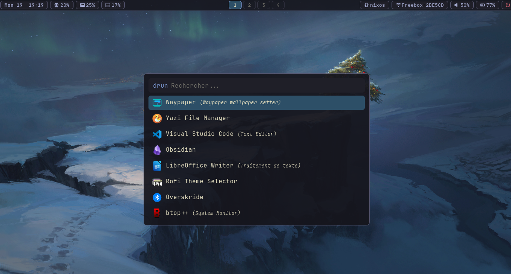
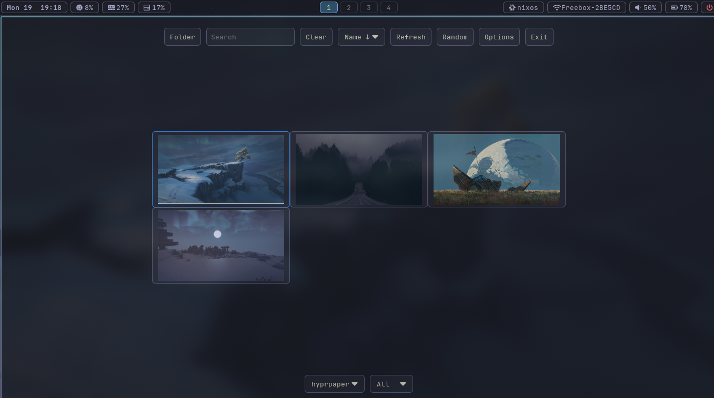
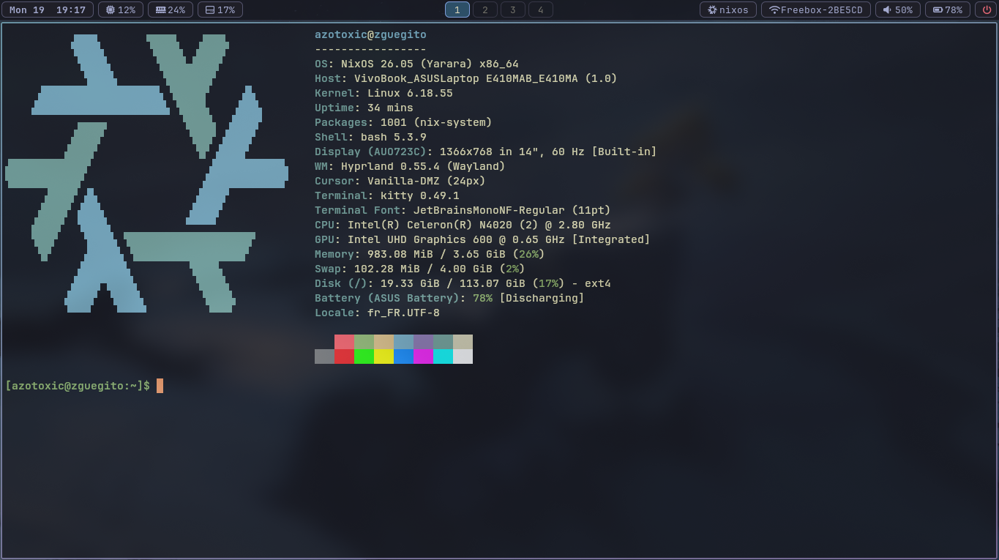

# NixOS Configuration

My configuration files for NixOS and my desktop environment. This repository includes settings for Hyprland, Waybar, and other tools I use.
Contents

    .config/ — application and desktop environment configurations
    etc/ — NixOS-related configuration files

# Usage

These files are tailored to my personal setup. Feel free to use them as inspiration, or adapt them to your own system before applying them.

# Showcase

# License

No license has been specified yet. Please ask for permission before reusing or redistributing these files.
